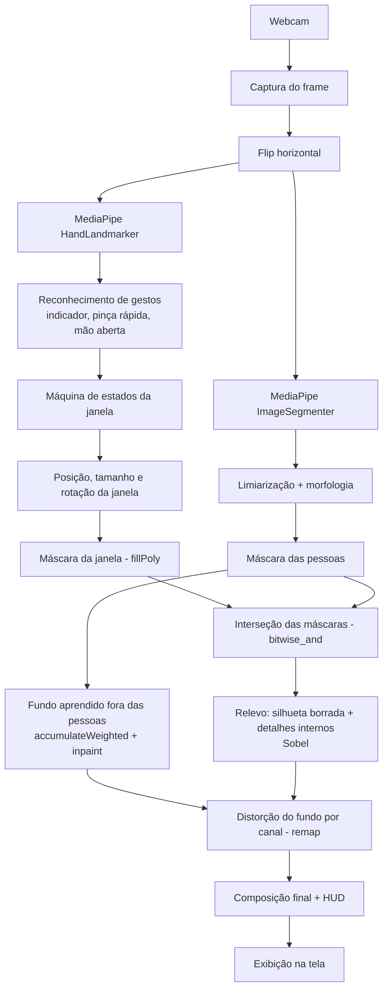
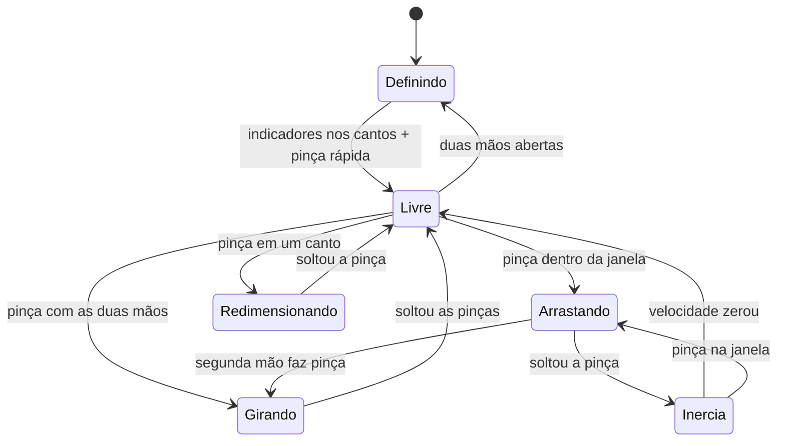
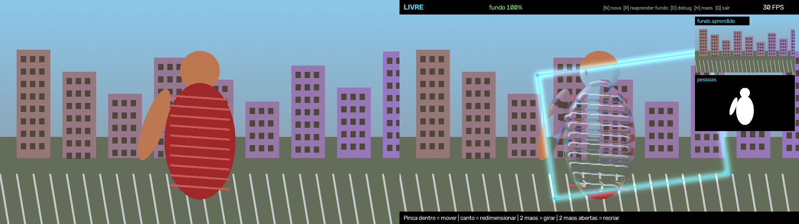

# Invisible Box – Janela de Invisibilidade com Visão Computacional

Projeto da disciplina **Cognitive Computing, Computer Vision and IoT Systems** (FIAP), módulo de **Processamento Digital de Imagens**.

## Descrição do projeto

O **Invisible Box** é uma aplicação em tempo real que usa a webcam para criar uma "janela de invisibilidade" controlada pelas mãos.

O usuário marca um retângulo no ar apontando com os dois indicadores e salva a área com uma pinça rápida. Dentro dessa área, qualquer pessoa que passar fica transparente: em vez da pessoa, aparece o fundo da cena, e o corpo vira apenas contornos de vidro que distorcem o que está atrás, como no efeito do filme *Predador*.

A janela não é estática: ela pode ser **arrastada, redimensionada, girada e arremessada** com gestos de pinça, em tempo real.

### Funcionalidades

- **Criar a janela com as mãos:** a ponta de cada indicador marca um canto do retângulo; uma pinça rápida (indicador encosta no polegar e solta) salva a área.
- **Detecção de pessoas:** segmentação de pessoas do MediaPipe (`ImageSegmenter`), limpa com limiarização e morfologia. Funciona com várias pessoas e com pessoas paradas.
- **Fundo aprendido com gente na cena:** não é preciso sair da frente da câmera. A cada frame, tudo que não é pessoa entra no fundo; quando alguém se mexe, o cenário que estava atrás é aprendido. O que nunca foi visto é preenchido com *inpainting* até aparecer.
- **Efeito de vidro transparente:** a pessoa é trocada pelo fundo e só sobra a refração. Um "relevo" feito da silhueta borrada mais os detalhes internos da pessoa (dedos, braços, roupa) passa pelo Sobel e vira mapa de deslocamento (`cv2.remap`). Cada canal de cor é deslocado com força diferente (aberração cromática), o que dá as franjas coloridas nas bordas.
- **Manipulação da janela por gestos:**
  - pinça dentro da janela → arrastar;
  - pinça em um canto → redimensionar;
  - pinça com as duas mãos → girar e escalar;
  - soltar em movimento → a janela desliza com inércia e quica nas bordas.

### Técnicas e laboratórios utilizados

| Técnica | Laboratório |
|---|---|
| Manipulação de pixels, canais e desenho (`line`, `putText`, `fillPoly`) | Lab01 |
| Limiarização da máscara de pessoas | Lab02 |
| Filtros de convolução: Gaussian Blur, passa-alta e Sobel | Lab04 |
| Máscaras, operações bitwise e canais de cor separados | Lab05 |
| Morfologia (abertura, fechamento e dilatação) | Lab06 |
| Modelo de fundo acumulado (`accumulateWeighted`) | Lab07 |
| Interação e seleção de região (ROI) | Lab11 |
| Gesto confirmado no tempo (pinça rápida) | Lab12 |
| Landmarks das mãos (HandLandmarker) e segmentação de pessoas (ImageSegmenter) | Lab13 |

### Tecnologias

- Python 3
- OpenCV
- MediaPipe (Tasks API – HandLandmarker e ImageSegmenter)
- NumPy

## Diagrama de funcionamento

### Pipeline por frame



### Estados da janela



## Como executar

Requisitos: Python 3.10+ e uma webcam. **A câmera precisa ficar parada** (apoiada ou em tripé), porque o efeito usa o fundo aprendido daquele ponto de vista.

```bash
python -m venv .venv
# Windows: .venv\Scripts\activate | Linux/macOS: source .venv/bin/activate
pip install -r requirements.txt
python download_models.py      # baixa os modelos de mãos e de segmentação (uma vez)
python main.py                 # use --camera 1 para outra câmera, --debug para ver fundo e máscara
```

### Como usar

1. **Fundo:** não precisa sair da frente da câmera. O HUD mostra quanto do fundo já foi visto (`fundo 87%`); mexa-se um pouco para que o cenário atrás de você também seja aprendido.
2. **Criar a janela:** aponte os dois indicadores para os cantos desejados (aparece um retângulo branco) e faça uma pinça rápida com qualquer uma das mãos: o indicador encosta no polegar e solta. A janela é salva com os cantos de logo antes da pinça.
3. **Mover:** pinça dentro da janela e arraste. Solte com a mão em movimento para arremessar.
4. **Redimensionar:** pinça em um dos cantos.
5. **Girar e escalar:** pinça com as duas mãos dentro da janela e gire/afaste as mãos.
6. **Recriar:** mostre as duas mãos abertas por ~1 segundo.

| Tecla | Ação |
|---|---|
| `N` | nova janela |
| `R` | reaprender o fundo do zero |
| `D` | mostrar fundo aprendido e máscara das pessoas |
| `H` | mostrar/ocultar o esqueleto das mãos |
| `S` | salvar captura em `capturas/` |
| `Q` / `Esc` | sair |

Os parâmetros (limiares da pinça, sensibilidade da máscara, força do vidro, atrito etc.) ficam em `invisible_box/config.py`.

Para calibrar com a sua webcam, rode `python calibrar.py`: ele abre o app com sliders dos parâmetros principais (segmentação, pinça e vidro), mostra a razão da pinça de cada mão e grava amostras (teclas `1` mãos sem pinça, `2` pinças rápidas). A tecla `S` salva medições e valores sugeridos em `calibracao.json`.

### Testes sem webcam

```bash
python -m tests.test_offline
```

Simula mãos (landmarks sintéticos) e uma cena com uma pessoa andando para testar gestos, criação da janela com pinça rápida, máquina de estados, fundo aprendido com a pessoa na cena e o efeito de vidro. O resultado visual é salvo em `tests/output/render.png`:



## Estrutura do projeto

```
invisible-box/
├── main.py                  # loop principal: câmera -> visão -> gestos -> efeito -> tela
├── download_models.py       # baixa o modelo do MediaPipe
├── requirements.txt
├── invisible_box/
│   ├── config.py            # todos os parâmetros ajustáveis
│   ├── hand_tracker.py      # MediaPipe HandLandmarker em modo VIDEO (Lab13)
│   ├── person_segmenter.py  # MediaPipe ImageSegmenter: máscara das pessoas (Lab13)
│   ├── gestures.py          # pinça com histerese, dedo esticado, mão aberta
│   ├── background.py        # fundo aprendido com pessoas na cena + inpaint (Lab07, Lab06)
│   ├── glass.py             # vidro transparente: relevo + Sobel + remap por canal (Lab04, Lab05)
│   ├── box.py               # geometria da janela: girar, redimensionar, inércia
│   ├── controller.py        # máquina de estados dos gestos
│   └── overlay.py           # contorno, HUD e painel de debug (Lab01)
├── calibrar.py              # sliders + medições para ajustar o config com a webcam
├── models/                  # modelos do MediaPipe (não versionados)
└── tests/test_offline.py    # testes sem webcam
```

## Integrantes

| Nome | RM |
|---|---|
| Pedro Henrique Lima | RM553664 |
| Murilo Fernandes | RM553582 |
| Thais Mari Costa | RM553620 |
| Bruno Furlan | RM553604 |
| Maria Alice Sousa | RM552717 |
