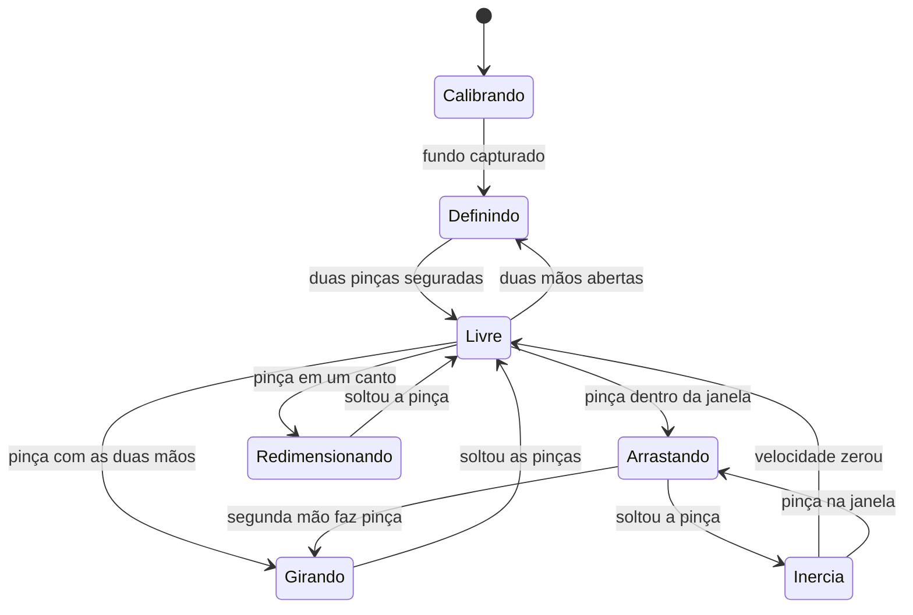

# Invisible Box – Janela de Invisibilidade com Visão Computacional

Projeto da disciplina **Cognitive Computing, Computer Vision and IoT Systems** (FIAP), módulo de **Processamento Digital de Imagens**.

## Descrição do projeto

O **Invisible Box** é uma aplicação em tempo real que usa a webcam para criar uma "janela de invisibilidade" controlada pelas mãos.

O usuário desenha um retângulo no ar com as duas mãos. Dentro dessa área, qualquer pessoa que passar fica "invisível": em vez da pessoa, aparece o fundo da cena, e o corpo vira apenas uma silhueta de vidro líquido que distorce o que está atrás, como no efeito do filme *Predador*.

A janela não é estática: ela pode ser **arrastada, redimensionada, girada e arremessada** com gestos de pinça, em tempo real.

### Funcionalidades

- **Criar a janela com as mãos:** uma pinça em cada mão define os cantos opostos do retângulo; segurando as duas pinças por alguns frames, a janela é criada.
- **Fundo da cena:** o fundo é aprendido automaticamente (subtração de fundo), permitindo mover a janela para qualquer região.
- **Detecção de pessoa:** diferença entre o frame atual e o fundo, com limpeza por morfologia.
- **Efeito de vidro:** a máscara da pessoa é suavizada e o seu gradiente (Sobel) é usado como mapa de deslocamento (`cv2.remap`), criando a refração nas bordas da silhueta.
- **Manipulação da janela por gestos:**
  - pinça dentro da janela → arrastar;
  - pinça em um canto → redimensionar;
  - pinça com as duas mãos → girar e escalar;
  - soltar em movimento → a janela desliza com inércia e quica nas bordas.

### Técnicas e laboratórios utilizados

| Técnica | Laboratório |
|---|---|
| Manipulação de pixels, canais e desenho (`line`, `putText`, `fillPoly`) | Lab01 |
| Limiarização da máscara | Lab02 / Lab04 |
| Filtros de convolução: Gaussian Blur e Sobel | Lab04 |
| Máscaras e operações bitwise | Lab05 |
| Morfologia (abertura e fechamento) | Lab06 |
| Subtração de fundo (absdiff, fundo acumulado) | Lab07 |
| Interação e seleção de região (ROI) | Lab11 |
| Confirmação de gesto por frames consecutivos | Lab12 |
| Landmarks das mãos (HandLandmarker) | Lab13 |

### Tecnologias

- Python 3
- OpenCV
- MediaPipe (Tasks API – HandLandmarker)
- NumPy

## Diagrama de funcionamento

### Pipeline por frame


### Estados da janela



## Como executar

Requisitos: Python 3.10+ e uma webcam. **A câmera precisa ficar parada** (apoiada ou em tripé), porque o efeito compara cada frame com o fundo aprendido.

```bash
python -m venv .venv
# Windows: .venv\Scripts\activate | Linux/macOS: source .venv/bin/activate
pip install -r requirements.txt
python download_models.py      # baixa models/hand_landmarker.task (uma vez)
python main.py                 # use --camera 1 para outra câmera, --debug para ver fundo e máscara
```

### Como usar

1. **Calibração:** ao abrir, saia da frente da câmera por ~2 segundos enquanto a barra enche.
2. **Criar a janela:** volte, faça pinça (polegar + indicador, com os outros dedos esticados, como um "OK") com as duas mãos nos cantos desejados e segure até a barra verde completar.
3. **Mover:** pinça dentro da janela e arraste. Solte com a mão em movimento para arremessar.
4. **Redimensionar:** pinça em um dos cantos.
5. **Girar e escalar:** pinça com as duas mãos dentro da janela e gire/afaste as mãos.
6. **Recriar:** mostre as duas mãos abertas por ~1 segundo.

| Tecla | Ação |
|---|---|
| `N` | nova janela |
| `R` | recalibrar o fundo |
| `D` | mostrar fundo aprendido e máscara da pessoa |
| `H` | mostrar/ocultar o esqueleto das mãos |
| `S` | salvar captura em `capturas/` |
| `Q` / `Esc` | sair |

Os parâmetros (limiares da pinça, sensibilidade da máscara, força do vidro, atrito etc.) ficam em `invisible_box/config.py`.

### Testes sem webcam

```bash
python -m tests.test_offline
```

Simula mãos (landmarks sintéticos) e uma cena com uma pessoa para testar gestos, máquina de estados e o efeito de vidro. O resultado visual é salvo em `tests/output/render.png`:


## Estrutura do projeto

```
invisible-box/
├── main.py                  # loop principal: câmera -> visão -> gestos -> efeito -> tela
├── download_models.py       # baixa o modelo do MediaPipe
├── requirements.txt
├── invisible_box/
│   ├── config.py            # todos os parâmetros ajustáveis
│   ├── hand_tracker.py      # MediaPipe HandLandmarker em modo VIDEO (Lab13)
│   ├── gestures.py          # pinça com histerese, punho, mão aberta
│   ├── background.py        # fundo da cena + máscara da pessoa (Lab07, Lab06)
│   ├── glass.py             # efeito de vidro: blur + Sobel + remap (Lab04, Lab05)
│   ├── box.py               # geometria da janela: girar, redimensionar, inércia
│   ├── controller.py        # máquina de estados dos gestos
│   └── overlay.py           # contorno, HUD, calibração e painel de debug (Lab01)
├── models/                  # hand_landmarker.task (não versionado)
└── tests/test_offline.py    # testes sem webcam
```

## Integrantes

| Nome | RM |
|---|---|
| Pedro Henrique Lima | RM553664 |
| Murilo Fernandes | RM553582 |
| Thais Mari Costa | RM553620 |
| Bruno Furlan | RM553604 |
| Maria Alice Sousa | RM552717 |

## Referências

- Material da disciplina: https://arnaldojr.github.io/cognitivecomputing/
- MediaPipe Hand Landmarker: https://ai.google.dev/edge/mediapipe/solutions/vision/hand_landmarker
- OpenCV Background Subtraction: https://docs.opencv.org/4.x/d1/dc5/tutorial_background_subtraction.html
