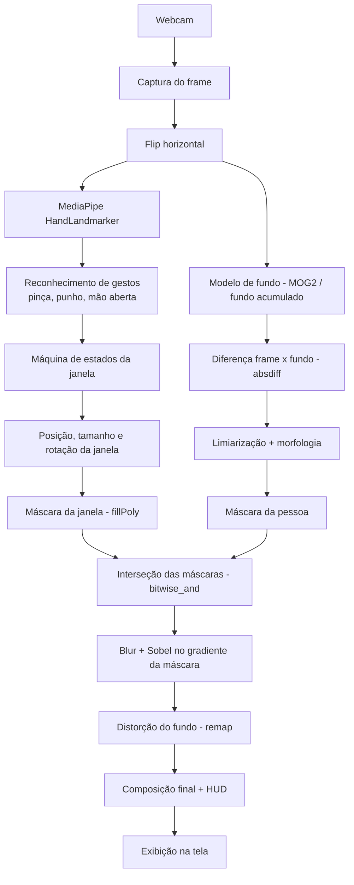
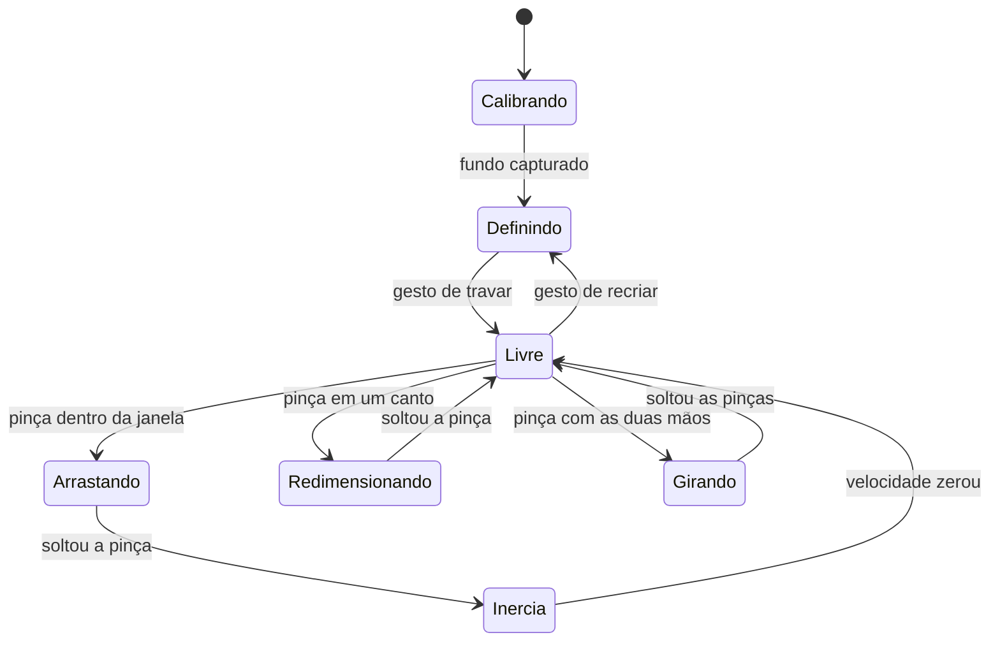

# Invisible Box – Janela de Invisibilidade com Visão Computacional

Projeto da disciplina **Cognitive Computing, Computer Vision and IoT Systems** (FIAP), módulo de **Processamento Digital de Imagens**.

## Descrição do projeto

O **Invisible Box** é uma aplicação em tempo real que usa a webcam para criar uma "janela de invisibilidade" controlada pelas mãos.

O usuário desenha um retângulo no ar com as duas mãos. Dentro dessa área, qualquer pessoa que passar fica "invisível": em vez da pessoa, aparece o fundo da cena, e o corpo vira apenas uma silhueta de vidro líquido que distorce o que está atrás, como no efeito do filme *Predador*.

A janela não é estática: ela pode ser **arrastada, redimensionada, girada e arremessada** com gestos de pinça, em tempo real.

### Funcionalidades

- **Criar a janela com as mãos:** as pontas dos indicadores das duas mãos definem os cantos do retângulo; um gesto trava a janela.
- **Fundo da cena:** o fundo é aprendido automaticamente (subtração de fundo), permitindo mover a janela para qualquer região.
- **Detecção de pessoa:** diferença entre o frame atual e o fundo, com limpeza por morfologia.
- **Efeito de vidro:** a máscara da pessoa é suavizada e o seu gradiente (Sobel) é usado como mapa de deslocamento (`cv2.remap`), criando a refração nas bordas da silhueta.
- **Manipulação da janela por gestos:**
  - pinça dentro da janela → arrastar;
  - pinça em um canto → redimensionar;
  - pinça com as duas mãos → girar;
  - soltar em movimento → a janela desliza com inércia e quica nas bordas.

### Técnicas e laboratórios utilizados

| Técnica | Laboratório |
|---|---|
| Manipulação de pixels, canais e desenho (`line`, `putText`, `fillPoly`) | Lab01 |
| Limiarização da máscara | Lab02 / Lab04 |
| Filtros de convolução: Gaussian Blur e Sobel | Lab04 |
| Máscaras e operações bitwise | Lab05 |
| Morfologia (abertura e fechamento) | Lab06 |
| Subtração de fundo (absdiff, MOG2) | Lab07 |
| Interação e seleção de região (ROI) | Lab11 |
| Confirmação de gesto por frames consecutivos | Lab12 |
| Landmarks das mãos (HandLandmarker) | Lab13 |

### Tecnologias

- Python 3
- OpenCV
- MediaPipe (Tasks API – HandLandmarker)
- NumPy

## Diagrama de funcionamento

### Pipeline por frame



### Estados da janela



## Como executar

> Em construção.

```bash
pip install opencv-python mediapipe numpy
python main.py
```

O modelo `hand_landmarker.task` deve estar na pasta `models/`.

## Integrantes

| Nome | RM |
|---|---|
| Nome do integrante 1 | RM000000 |
| Nome do integrante 2 | RM000000 |
| Nome do integrante 3 | RM000000 |

## Referências

- Material da disciplina: https://arnaldojr.github.io/cognitivecomputing/
- MediaPipe Hand Landmarker: https://ai.google.dev/edge/mediapipe/solutions/vision/hand_landmarker
- OpenCV Background Subtraction: https://docs.opencv.org/4.x/d1/dc5/tutorial_background_subtraction.html
